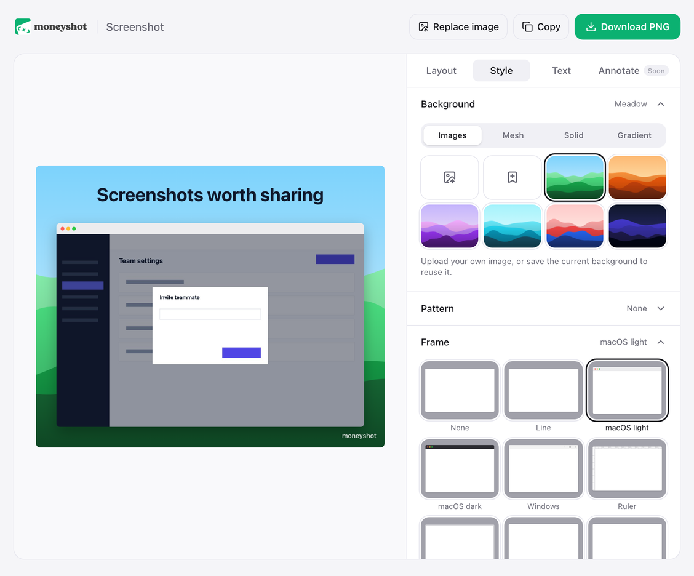

<p align="center">
  <picture>
    <source media="(prefers-color-scheme: dark)" srcset="assets/logo_white.png" />
    
  </picture>
</p>

<p align="center">
  <strong>Screenshots worth sharing.</strong><br />
  An open source screenshot editor. Capture any page and make it beautiful, right in your
  browser.
</p>

<p align="center">
  <a href="LICENSE"></a>
  
  <a href="https://github.com/shashankbhat2/moneyshot/actions/workflows/ci.yml"></a>
</p>

<p align="center">
  
</p>

## Features

|  |  |
| --- | --- |
| **Capture** | The visible area, the full page or a selection. Or upload, drop or paste any image. |
| **Backgrounds** | Wallpapers, mesh gradients, solids and gradients, or your own image. Save favorites. |
| **Patterns** | Dots, grid, waves, stripes, checks or plus over any background, in any color. |
| **Frames** | macOS light and dark, Windows, Arc, ruler and stacked cards, with radius and shadow. |
| **Sizes** | Ratios, plus exact sizes for X, LinkedIn, Instagram, YouTube, Dribbble, Product Hunt, the App Store, Play Store and Chrome Web Store. |
| **Layout** | Padding, zoom, rotation and 3D tilt. Drag the screenshot and text, with center guides. |
| **Text** | A headline above or below the screenshot, and a watermark in any corner. |
| **Export** | Download a PNG or copy it to the clipboard. |

Everything runs in your browser. Screenshots never leave your computer.

## How it works

1. Click the Moneyshot icon in Chrome, or press <kbd>⌥</kbd> <kbd>⇧</kbd> <kbd>S</kbd>.
2. Pick **Visible area**, **Full page** or **Selection**.
3. Style it in the editor, then download or copy the PNG.

## Repository

```
apps/
  extension/   Chrome extension: React, TypeScript, Tailwind, Vite
  site/        Website: Astro, Tailwind
```

## Development

You need Node 22 and pnpm.

```sh
pnpm install
pnpm dev          # extension and site in watch mode
pnpm build        # build everything
pnpm test         # Vitest
pnpm typecheck
pnpm lint         # Biome
```

### Load the extension

1. `pnpm --filter @moneyshot/extension dev` (or `build`).
2. Open `chrome://extensions` and turn on **Developer mode**.
3. Click **Load unpacked** and choose `apps/extension/dist`.

### Run the site

```sh
pnpm --filter @moneyshot/site dev
```

## Contributing

Issues and pull requests are welcome. Run `pnpm lint`, `pnpm typecheck` and `pnpm test` before
opening a pull request.

## License

[AGPL-3.0](LICENSE)
